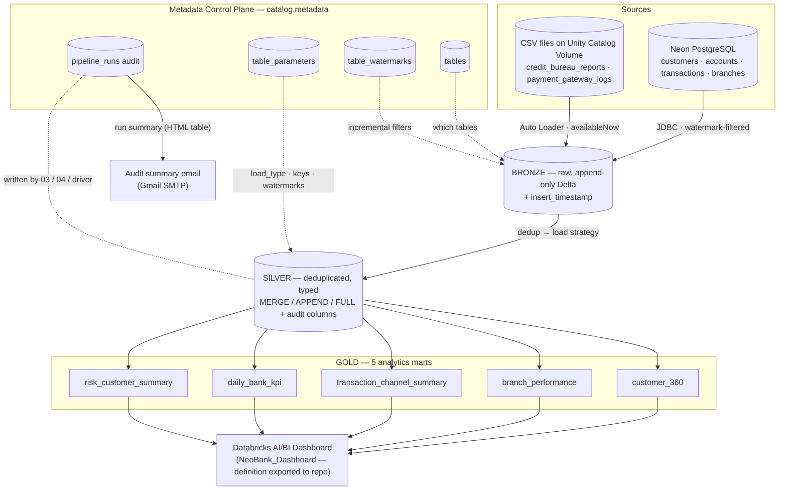
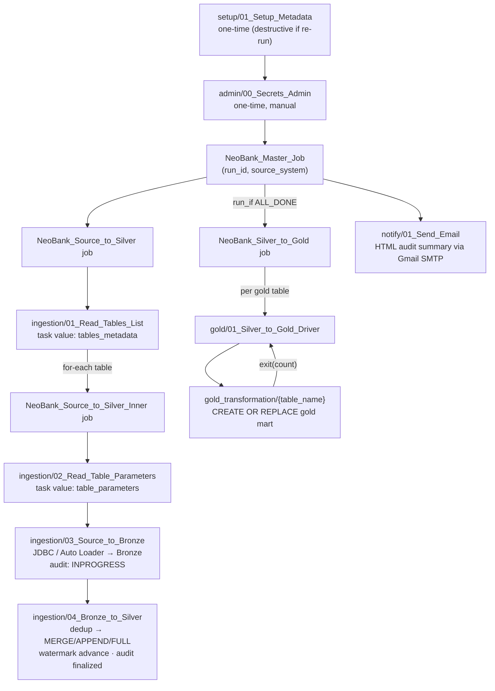

# NeoBank — Banking Data Engineering Platform (Databricks)

NeoBank is an end-to-end, **metadata-driven banking data engineering platform** built on Databricks. It ingests data from a **Neon PostgreSQL** operational database and **CSV files**, lands it in a **Bronze → Silver → Gold medallion architecture** on Delta Lake, and serves analytics through five Gold data marts, a Databricks AI/BI dashboard, and automated email run reports.

> **Status legend used throughout this README**
> * ✅ **Implemented & run in production** — exists in the original production pipeline with historical run evidence
> * 🟡 **Implemented in this repo, not yet re-tested** — the sanitized, parameterized copies in this repository have never been executed end-to-end
> * ⏳ **Pending** — planned / requires user action
> * 🔬 **Requires verification** — could not be fully confirmed from the repository contents

---

## Table of Contents

1. [Project Introduction](#1-project-introduction)
2. [Project Highlights](#2-project-highlights)
3. [Technology Stack](#3-technology-stack)
4. [System Architecture](#4-system-architecture)
5. [Repository Structure](#5-repository-structure)
6. [Data Sources](#6-data-sources)
7. [Metadata-Driven Framework](#7-metadata-driven-framework)
8. [Medallion Architecture](#8-medallion-architecture)
9. [Gold Tables and Business Logic](#9-gold-tables-and-business-logic)
10. [Audit and Monitoring](#10-audit-and-monitoring)
11. [Prerequisites](#11-prerequisites)
12. [Configuration and Secret Setup](#12-configuration-and-secret-setup)
13. [Step-by-Step Project Setup](#13-step-by-step-project-setup)
14. [Pipeline Execution Flow](#14-pipeline-execution-flow)
15. [Data Validation and Testing](#15-data-validation-and-testing)
16. [Dashboard](#16-dashboard)
17. [Known Limitations and Pending Improvements](#17-known-limitations-and-pending-improvements)
18. [Security](#18-security)
19. [Future Enhancements](#19-future-enhancements)
20. [How to Use This Repository](#20-how-to-use-this-repository)
21. [Author and Project Summary](#21-author-and-project-summary)

---

## 1. Project Introduction

**What is NeoBank?**
NeoBank is a demo banking domain (customers, accounts, transactions, branches, credit reports, payment gateway logs) used as a realistic scenario for a production-style data platform. All data is synthetic.

**What business problem does it solve?**
A bank's data is born in operational systems — a PostgreSQL database powering the core banking app, and CSV files dropped by external partners (a credit bureau, a payment gateway). That data is:

* scattered across systems with different formats and latencies,
* raw and untrusted for analytics (duplicates, no history, no lineage),
* impossible to join for business questions like "which branch has the most high-value customers?"

**Why this platform?**
This project builds a governed, automated ELT pipeline that consolidates both sources into a single Databricks lakehouse, standardizes them, and produces analytics-ready datasets — without any hard-coded table logic in the pipeline code. *Which* tables to load, *how* to load them (incremental vs. full), and *how* to deduplicate them is all decided by metadata tables, so adding a new source table is a metadata change, not a code change.

**Main objectives**

1. Ingest from heterogeneous sources (JDBC database + file drops) with one framework.
2. Incremental, restartable loading driven by watermarks.
3. Idempotent, duplicate-free Silver tables (MERGE / APPEND / FULL strategies).
4. Audit every table-load of every run (rows, status, errors).
5. Produce business-facing Gold marts and a dashboard.
6. Notify stakeholders automatically by email with the run summary.

**What the final output provides**
Five Gold analytics tables — a 360° customer view, branch performance, daily KPIs, transaction-channel analytics, and a credit-risk summary — powering an executive dashboard, plus a per-run audit email. Business users can answer questions about customer value segments, branch deposits and activity, channel reliability, and portfolio risk without touching engineering tables.

---

## 2. Project Highlights

| # | Feature | Status | Where |
| --- | --- | --- | --- |
| 1 | Metadata-driven ingestion & load configuration | ✅ / 🟡 | `metadata.tables`, `metadata.table_parameters` |
| 2 | Medallion architecture (Bronze / Silver / Gold) | ✅ / 🟡 | `banking.bronze.*`, `banking.silver.*`, `banking.gold.*` |
| 3 | Incremental loading via watermarks | ✅ / 🟡 | `metadata.table_watermarks` + `03`/`04` notebooks |
| 4 | JDBC ingestion from Neon PostgreSQL | ✅ / 🟡 | `03_Source_to_Bronze` (Spark JDBC reader) |
| 5 | CSV ingestion with Auto Loader (cloudFiles, `trigger availableNow`) | ✅ / 🟡 | `03_Source_to_Bronze` (blob branch) |
| 6 | PySpark transformations | ✅ / 🟡 | `04_Bronze_to_Silver`, `01_Read_Tables_List` |
| 7 | Delta Lake tables + `DESCRIBE HISTORY` metrics | ✅ / 🟡 | all layers |
| 8 | MERGE / APPEND / FULL load strategies | ✅ / 🟡 | `04_Bronze_to_Silver` |
| 9 | Primary-key deduplication before audit stamping | ✅ / 🟡 | `04_Bronze_to_Silver` (`row_number()` window) |
| 10 | Watermark management (update only after success) | ✅ / 🟡 | `04_Bronze_to_Silver` |
| 11 | Per-run, per-table audit logging | ✅ / 🟡 | `metadata.pipeline_runs` |
| 12 | Five Gold analytical data marts | ✅ / 🟡 | `gold_transformation/` notebooks |
| 13 | Email notifications (Gmail SMTP, HTML audit table) | ✅ / 🟡 | `01_Send_Email` |
| 14 | Databricks AI/BI Dashboard | ✅ definition exported & committed (validated 17 Nov 2026) | `dashboards/NeoBank_Dashboard.lvdash.json` |
| 15 | Fail-fast parameter validation (run_id numeric, catalog present) | 🟡 | all parameterized notebooks |
| 16 | Production job orchestration (4 jobs) | ✅ in workspace / ⏳ not captured in this repo | see [Section 14](#14-pipeline-execution-flow) |

✅/🟡 means: the logic ran in production, but this repository's sanitized copies have not yet been executed (see [Section 17](#17-known-limitations-and-pending-improvements)).

---

## 3. Technology Stack

| Technology | Purpose | How it is used in this project |
| --- | --- | --- |
| Databricks (notebooks + jobs) | Lakehouse platform | 13 notebooks run manually or orchestrated by 4 Lakeflow Jobs (jobs not in this repo) |
| Apache Spark / PySpark | Distributed processing | JDBC reads, DataFrame transformations, streaming writes in `03`/`04` |
| Delta Lake | Storage format | All Bronze/Silver/Gold tables and metadata tables are Delta; `DESCRIBE HISTORY` metrics for rows written |
| Unity Catalog | Governance & naming | Catalog `banking` with schemas `bronze`, `silver`, `gold`, `metadata`; table-level FQNs built from the `catalog_name` parameter |
| Neon PostgreSQL | Operational source database | Core banking tables (`customers`, `accounts`, `transactions`, `branches`) read over JDBC |
| JDBC (PostgreSQL driver) | Database connectivity | `spark.read.jdbc` with watermark-filtered subqueries; SSL required |
| Auto Loader (`cloudFiles`) | File ingestion | CSV drops (credit bureau, payment gateway) with schema inference + checkpoints, `trigger(availableNow=True)` |
| SQL (Databricks SQL + ANSI) | Transformations | Gold marts are `CREATE OR REPLACE TABLE ... AS SELECT` statements; metadata DDL in Databricks SQL |
| Python (smtplib / email.mime) | Notifications | HTML audit email over Gmail SMTP with an app password from Databricks Secrets |
| Databricks Workflows (Jobs) | Orchestration | Master → Source-to-Silver (+ Inner per-table loop) → Silver-to-Gold → email (see [Section 14](#14-pipeline-execution-flow)) |
| Git (GitHub) | Version control | This repository (sanitized, secrets-free copies) |

---

## 4. System Architecture



**How to read this:** solid arrows are data flow; dotted arrows are control flow. Every layer consults the metadata control plane (`banking.metadata`) instead of hard-coded configuration:

* **`tables`** — the registry: *which* logical tables exist, their source (JDBC vs. blob), Bronze/Silver schemas, and load order.
* **`table_parameters`** — *how* to load each: `load_type` (MERGE/APPEND/FULL), `primary_key`, `watermark_column`.
* **`table_watermarks`** — *where* each incremental table last stopped; used to filter source reads and updated only after a successful Silver load.
* **`pipeline_runs`** — the audit trail: one row per table per run per layer-group, with status, timestamps, row counts, and error messages.

---

## 5. Repository Structure

```text
NeoBank-Data-Engineering-Project/
├── README.md                        # this file
├── .gitignore                       # excludes configs with real endpoints, data files, secrets
├── config/
│   └── config.example.json           # placeholder-only environment template
├── docs/
│   ├── EXCLUSIONS.md                 # what is intentionally NOT committed, and why
│   ├── VALIDATION_REPORT.md          # end-to-end read-only validation (17 Nov 2026)
│   └── DASHBOARD_IMPORT_GUIDE.md    # how to import the dashboard into another workspace
├── notebooks/
│   ├── admin/
│   │   └── 00_Secrets_Admin.ipynb    # one-time, manual secret-scope setup (getpass; never printed)
│   ├── setup/
│   │   └── 01_Setup_Metadata.ipynb   # first-time catalog + metadata creation (DESTRUCTIVE on re-run)
│   ├── ingestion/
│   │   ├── 01_Read_Tables_List.ipynb
│   │   ├── 02_Read_Table_Parameters.ipynb
│   │   ├── 03_Source_to_Bronze.ipynb
│   │   └── 04_Bronze_to_Silver.ipynb
│   ├── gold/
│   │   ├── 01_Silver_to_Gold_Driver.ipynb
│   │   └── gold_transformation/
│   │       ├── customer_360.ipynb
│   │       ├── branch_performance.ipynb
│   │       ├── transaction_channel_summary.ipynb
│   │       ├── daily_bank_kpi.ipynb
│   │       └── risk_customer_summary.ipynb
│   └── notify/
│       └── 01_Send_Email.ipynb
├── sql/
│   └── source_ddl/
│       └── 01_Create_Tables.sql     # reference DDL — SQL Server/T-SQL dialect (see warning inside)
└── dashboards/
    └── NeoBank_Dashboard.lvdash.json  # exported AI/BI dashboard definition (verified byte-identical)
```

### The 13 Notebooks

| # | Notebook | Responsibility | Input | Output | Called by |
| --- | --- | --- | --- | --- | --- |
| 1 | `admin/00_Secrets_Admin` | Create secret scope `banking-scope` and store the 3 pipeline secrets interactively (`getpass`); verifies keys only, never prints values | Manual admin input | Secret scope with `neon-username`, `neon-password`, `gmail_app_password` | **Nobody** — manual, one-time, no job references it |
| 2 | `setup/01_Setup_Metadata` | First-time environment creation: catalog `banking`, schemas, the 4 metadata tables (DDL + seed inserts for all 6 sources + 5 gold tables) | None (hardcodes `banking` by design) | `banking.metadata.*` populated | Manual, once — **⚠️ cell 2 DROPs the 4 metadata tables** |
| 3 | `ingestion/01_Read_Tables_List` | Read the table registry for one `source_system`, ordered by `load_order`; publish it as task value `tables_metadata` | Widgets: `source_system`, `catalog_name` | Task value `tables_metadata` (list of dicts) | `NeoBank_Source_to_Silver` job (first task) |
| 4 | `ingestion/02_Read_Table_Parameters` | Look up `load_type`, `primary_key`, `watermark_column` for one `table_id`; publish task value `table_parameters` | Widgets: `table_metadata` (job parameter), `catalog_name` | Task value `table_parameters` (dict) | `NeoBank_Source_to_Silver_Inner` job |
| 5 | `ingestion/03_Source_to_Bronze` | Incremental extraction from Neon (JDBC, `>` watermark filter) or CSV volume (Auto Loader), append raw data to Bronze with `insert_timestamp`; open an INPROGRESS audit row; on failure mark FAILED with the error | Widgets: `run_id` (numeric), `table_metadata`, `table_parameters`, `catalog_name`, `neon_host`, `neon_port`, `neon_database`, `volume_base` | Rows appended to `<catalog>.bronze.<table>`; audit row `INPROGRESS` | `NeoBank_Source_to_Silver_Inner` job |
| 6 | `ingestion/04_Bronze_to_Silver` | Dedup on primary key → stamp audit columns → load Silver per strategy (MERGE with freshness guard / APPEND / FULL overwrite) → count actual rows written from Delta history → update watermark on success → finalize the audit row (SUCCESS/FAILED, rows read) in `finally` | Same widgets as #5 | `<catalog>.silver.<table>` upserted/overwritten; watermark row updated; audit row finalized | `NeoBank_Source_to_Silver_Inner` job |
| 7 | `gold/01_Silver_to_Gold_Driver` | For one gold table: open/update a Gold audit row → run the transformation notebook by relative path `gold_transformation/{table_name}` → capture its exit value (row count) → finalize the audit row → raise on failure | Widgets: `run_id` (numeric), `table_metadata`, `catalog_name` | Audit rows; delegated transformation | `NeoBank_Silver_to_Gold` job (per gold table) |
| 8 | `gold_transformation/customer_360` | Build the 360° customer mart (see [Section 9](#9-gold-tables-and-business-logic)) | Hardcoded `banking` catalog (documented limitation) | `banking.gold.customer_360` replaced; exits with row count | Driver #7 via `dbutils.notebook.run` |
| 9 | `gold_transformation/branch_performance` | Branch-level aggregation of customers, accounts, balances, transactions | Same | `banking.gold.branch_performance` | Driver #7 |
| 10 | `gold_transformation/transaction_channel_summary` | Transactions × payment-gateway join by date/gateway/device | Same | `banking.gold.transaction_channel_summary` | Driver #7 |
| 11 | `gold_transformation/daily_bank_kpi` | Daily KPI snapshot (customers, accounts, balances, txn volumes, credit stats) | Same | `banking.gold.daily_bank_kpi` | Driver #7 |
| 12 | `gold_transformation/risk_customer_summary` | Credit-risk aggregation by risk grade | Same | `banking.gold.risk_customer_summary` | Driver #7 |
| 13 | `notify/01_Send_Email` | Query `pipeline_runs` for the run, compute overall status, render an HTML table, send via Gmail SMTP | Widgets: `run_id`, `sender_email`, `recipient_email`, `catalog_name` | Email "NeoBank | SUCCESS/FAILED | End to End Run" | `NeoBank_Master_Job` → Email_Notification task |

> **Notebook dependency chain:** `01_Read_Tables_List` → (per table, via job loop) `02_Read_Table_Parameters` → `03_Source_to_Bronze` → `04_Bronze_to_Silver`; separately (per gold table) `01_Silver_to_Gold_Driver` → `gold_transformation/{name}`; finally `01_Send_Email`. The chain is wired by **jobs**, not by notebook-to-notebook calls (except driver → transformation).

---

## 6. Data Sources

### Neon PostgreSQL (JDBC)

Four operational tables in the `banking` schema of a Neon PostgreSQL database, read with `spark.read.jdbc` (`org.postgresql.Driver`, `sslmode=require`). Incremental tables are filtered **at the source** with `WHERE watermark_column > last_watermark` before any data lands in Databricks.

| Source table | Primary key | Watermark column | Load type | Bronze target | Silver target |
| --- | --- | --- | --- | --- | --- |
| `banking.customers` | `customer_id` | `updated_at` | MERGE | `banking.bronze.customers` | `banking.silver.customers` |
| `banking.accounts` | `account_id` | `updated_at` | MERGE | `banking.bronze.accounts` | `banking.silver.accounts` |
| `banking.transactions` | `txn_id` | `txn_timestamp` | MERGE | `banking.bronze.transactions` | `banking.silver.transactions` |
| `banking.branches` | `branch_code` | — (full load) | FULL | `banking.bronze.branches` | `banking.silver.branches` |

> **Note (live configuration):** the production `metadata.table_parameters` registers `transactions` as **MERGE** (verified 17 Nov 2026, consistent with `silver.transactions` Delta history). The `01_Setup_Metadata` seed still inserts `APPEND` for this table — a known metadata drift; see `docs/VALIDATION_REPORT.md` (check #17).

Key columns (verified against the live source schema):

* **customers**: `customer_id`, `first_name`, `last_name`, `date_of_birth`, `pan_number`, `email`, `phone_number`, `kyc_status`, `branch_code`, `created_at`, `updated_at`
* **accounts**: `account_id`, `customer_id`, `account_type`, `balance`, `currency`, `branch_code`, `status`, `opened_date`, `created_at`, `updated_at`
* **transactions**: `txn_id`, `account_id`, `txn_type`, `amount`, `txn_timestamp`, `channel`, `status`, `created_at`
* **branches**: `branch_code`, `branch_name`, `city`, `state`, `region`, `created_at`

### CSV files (Auto Loader)

Two partners drop CSVs on a Unity Catalog volume (paths come from `metadata.tables.source_path`, rooted at the `volume_base` parameter):

| Source folder | Primary key | Watermark column | Load type | Bronze target | Silver target |
| --- | --- | --- | --- | --- | --- |
| `credit_bureau_reports/` | `customer_id` | `bureau_pull_date` | MERGE | `banking.bronze.credit_bureau_reports` | `banking.silver.credit_bureau_reports` |
| `payment_gateway_logs/` | `txn_id` | `processed_timestamp` | APPEND | `banking.bronze.payment_gateway_logs` | `banking.silver.payment_gateway_logs` |

Ingestion uses Auto Loader (`cloudFiles` format `csv`, header row, inferred schema). Checkpoints live at `{volume_base}/_checkpoints/{table}` and schema hints at `{volume_base}/_schema/{table}` — both are runtime state, never committed. Streams run with `trigger(availableNow=True)`: batch-like behavior, then stop.

### Where connection configuration lives

* **Never in this repository.** Non-secret connection settings (host, port, database name, catalog, volume root, notification emails) live in a **local** copy of `config/config.example.json` (gitignored — see [Section 12](#12-configuration-and-secret-setup)).
* **Credentials** (`neon-username`, `neon-password`, `gmail_app_password`) live **only** in the Databricks secret scope `banking-scope` and are read at runtime with `dbutils.secrets.get`.

---

## 7. Metadata-Driven Framework

All pipeline behavior is decided by four Delta tables in `banking.metadata` (created and seeded by `setup/01_Setup_Metadata`):

| Metadata table | Purpose (columns) | Read by | Written by |
| --- | --- | --- | --- |
| `tables` | Registry of logical tables — `table_id`, `table_name`, `source_system` (`sqlserver` = JDBC legacy label / `blob` = CSV / `silver` = gold-mart origin), `source_schema`, `source_table`, `source_path`, `target_layer`, `bronze_schema`, `silver_schema`, `gold_schema`, `active_flag`, `load_order` | `01_Read_Tables_List`, driver | `01_Setup_Metadata` (seed) |
| `table_parameters` | Load rules per table — rows of (`table_id`, `parameter_name`, `parameter_value`) for `load_type`, `primary_key`, `watermark_column` | `02_Read_Table_Parameters` | `01_Setup_Metadata` (seed) |
| `table_watermarks` | Incremental state — `table_id`, `last_watermark_value` (string), `last_updated_at`, `last_run_id`; partitioned by `table_id`; seeded at `1900-01-01 00:00:00` | `03` (source filter), `04` (Silver filter) | `04` (only after successful load) |
| `pipeline_runs` | Audit trail — `run_id`, `table_id`, `layer`, `start_time`, `end_time`, `status` (`INPROGRESS`/`SUCCESS`/`FAILED`), `number_of_records`, `error_message`; partitioned by `table_id` | `01_Send_Email` | `03`, `04`, gold driver |

### How the framework decides what to do

1. **Which tables to process** → `tables` filtered by `active_flag = true` and `source_system`, ordered by `load_order`.
2. **Which load strategy** → `table_parameters.load_type`: `MERGE` (upsert), `APPEND` (insert-only), `FULL` (truncate-and-reload via overwrite).
3. **Primary key** → `table_parameters.primary_key` (dedup in Silver, MERGE condition).
4. **Watermark column** → `table_parameters.watermark_column` (source filter for incremental reads; tables without one, e.g. `branches`, are FULL loads).
5. **How incremental works** → `03` reads `WHERE watermark_column > last_watermark` from the source (JDBC) or processes new files (Auto Loader checkpoint state); `04` re-applies a watermark filter on Bronze for MERGE (inclusive `>=` so boundary rows are safely re-upserted) and APPEND (strict `>`).
6. **How watermarks update** → after a successful Silver load, `04` computes `max(watermark_column)` from the processed batch and MERGEs it into `table_watermarks`. A failed run never advances the watermark, so the next run re-reads the same window — incremental loads are **restart-safe**.

### Worked example — hypothetically adding a `cards` table

Suppose the bank launches a `cards` product in PostgreSQL.

1. Add a registry row: `INSERT INTO banking.metadata.tables VALUES (12, 'cards', 'sqlserver', 'banking', 'cards', NULL, 'silver', 'bronze', 'silver', NULL, TRUE, 7, current_timestamp());`
2. Add its rules: `INSERT INTO banking.metadata.table_parameters VALUES (12, 'load_type', 'MERGE', current_timestamp()), (12, 'primary_key', 'card_id', current_timestamp()), (12, 'watermark_column', 'updated_at', current_timestamp());`
3. Seed its watermark: `INSERT INTO banking.metadata.table_watermarks VALUES (12, '1900-01-01 00:00:00', current_timestamp(), NULL);`
4. Nothing else changes. On the next run, `01_Read_Tables_List` picks it up (load_order 7), `03` extracts rows with `updated_at > 1900-01-01` into `banking.bronze.cards`, and `04` MERGEs them into `banking.silver.cards` keyed on `card_id`.

*(Example only — table 12 does not exist in the seeded metadata.)*

---

## 8. Medallion Architecture

### Bronze — "land it exactly as it came"

* Raw, **append-only** Delta copies of source data. Every row gets `insert_timestamp`.
* JDBC tables: extracted incrementally by watermark; nothing is modified, deduplicated or dropped.
* CSV sources: Auto Loader with checkpointing, so files are processed exactly once.
* Bronze is never edited downstream — it is the replayable history of what the source sent.

### Silver — "one clean, current row per business entity"

1. **Watermark filter** (batch read from Bronze): `>=` last watermark for MERGE (inclusive — boundary rows may update to identical values, keeping the load idempotent), strict `>` for APPEND (an accidental re-run can never duplicate rows the target already holds).
2. **Deduplication before audit stamping**: `row_number()` over a window partitioned by the primary key, ordered by `watermark_column DESC` (fallback `created_at`, then Bronze `insert_timestamp`); only `_rn = 1` survives. Because this happens **before** the audit columns are stamped, ordering is deterministic on source values.
3. **Audit columns**: `insert_timestamp` and `update_timestamp` are (re)stamped on the surviving rows.
4. **Load strategy**:
   * **MERGE** — `DeltaTable.merge` on `t.<pk> = s.<pk>` with a freshness guard: only rows where `source.watermark >= target.watermark` are updated, so stale source rows can never regress a newer Silver row.
   * **APPEND** — plain append; safe for insert-only event tables.
   * **FULL** — `overwrite` with `overwriteSchema=true`; snapshot-style tables (`branches`).
   * Empty batches (0 rows) never write anything — a guard prevents overwriting a table with nothing.
5. **Actual rows written** are read from `DESCRIBE HISTORY` operation metrics (MERGE: `numTargetRowsInserted + numTargetRowsUpdated`; others: `numOutputRows`) — not the attempted count.
6. **Watermark advance** on success only.

### Gold — "business-ready marts"

Five `CREATE OR REPLACE TABLE ... AS SELECT` marts rebuilt from Silver on every run (definitions in [Section 9](#9-gold-tables-and-business-logic)). They are dashboard-ready, denormalized, and business-named.

### A record's journey (concrete example)

A customer updates their phone number in the banking app at 10:00:

1. `banking.customers` (Neon) now has `updated_at = 10:00` for that `customer_id`.
2. Next run: `03` reads customers where `updated_at > last_watermark` → the changed row lands in `banking.bronze.customers` with `insert_timestamp`.
3. `04` filters Bronze `>= last_watermark`, dedups on `customer_id` (the 10:00 row wins), stamps audit columns, and MERGEs into `banking.silver.customers` — the freshness guard lets the newer row overwrite the older one.
4. The watermark advances to 10:00; `pipeline_runs` gets `SUCCESS` with the row count.
5. The next gold rebuild picks up the corrected phone number in `customer_360`.

---

## 9. Gold Tables and Business Logic

All five marts read from `banking.silver.*` and write `banking.gold.*` (catalog hardcoded to `banking` — documented limitation, [Section 17](#17-known-limitations-and-pending-improvements)). Each transformation notebook ends with `dbutils.notebook.exit(str(count))`, returning its row count to the driver for the audit row.

### 9.1 `customer_360`

* **Purpose:** one row per customer combining identity, branch, account totals, transaction totals, and their latest credit-bureau snapshot.
* **Sources:** `silver.customers`, `silver.accounts`, `silver.transactions`, `silver.branches`, `silver.credit_bureau_reports`.
* **Key columns produced:** `customer_id`, `customer_name` (`first_name || ' ' || last_name`), `branch_name`, `total_accounts`, `total_balance`, `total_transactions`, `total_transaction_amount`, `credit_score`, `risk_grade`, `external_active_loans`, `external_overdue_amount`, `customer_segment`.
* **Calculations:** account aggregates (`COUNT(account_id)`, `SUM(balance)`) per customer; transaction aggregates via a join of transactions → accounts → customer; latest credit report via `ROW_NUMBER() OVER (PARTITION BY customer_id ORDER BY bureau_pull_date DESC)` keeping `rn = 1`.
* **Segment rule (as coded):** `total_balance >= 500000 → 'HIGH_VALUE'`, `>= 100000 → 'MEDIUM_VALUE'`, else `'LOW_VALUE'`.
* **Questions it answers:** *Who are our high-value customers and which branch serves them? What is a customer's total relationship balance and current credit score?*

### 9.2 `branch_performance`

* **Purpose:** branch-level roll-up of customers, accounts, deposits and transaction activity.
* **Sources:** `silver.branches`, `silver.customers`, `silver.accounts`, `silver.transactions` (transactions via accounts join).
* **Key columns produced:** `branch_code`, `branch_name`, `total_customers` (distinct), `total_accounts`, `total_deposits` (sum of balances), `total_transactions`, `total_transaction_amount`.
* **Questions:** *Which branches hold the most deposits? Which branch has the most customers but the least transaction activity?*

### 9.3 `transaction_channel_summary`

* **Purpose:** reliability and volume of payment channels by day.
* **Sources:** `silver.transactions` INNER JOIN `silver.payment_gateway_logs` ON `txn_id`.
* **Key columns produced:** `txn_date`, `gateway_name`, `device_type`, `total_transactions`, `successful_transactions`, `failed_transactions`, `avg_processing_time_ms` (success/fail derived from `gateway_status = 'SUCCESS'/'FAILED'`).
* **Questions:** *Which gateway+device combination fails most? Are processing times degrading on peak days?*

### 9.4 `daily_bank_kpi`

* **Purpose:** a daily executive snapshot across the whole bank.
* **Sources:** `silver.transactions`, `silver.customers`, `silver.accounts`, `silver.credit_bureau_reports` (the latter three as cross-joined whole-bank metrics).
* **Key columns produced:** `txn_date`, `total_customers`, `total_accounts`, `total_balance`, `total_transactions`, `total_transaction_amount`, `avg_credit_score`, `high_risk_customers` (count where `risk_grade = 'HIGH'`).
* **Questions:** *How did transaction volume and bank balance move day over day? What share of the book is high-risk?*

### 9.5 `risk_customer_summary`

* **Purpose:** credit-risk portfolio profile by risk grade.
* **Sources:** `silver.credit_bureau_reports`.
* **Key columns produced:** `risk_grade`, `total_customers`, `avg_credit_score`, `total_external_loans` (sum of `external_active_loans`), `total_overdue_amount` (sum of `external_overdue_amount`).
* **Questions:** *How many customers sit in each risk grade, and how much external debt and overdue exposure does each grade carry?*

---

## 10. Audit and Monitoring

Every table-load of every run writes to `banking.metadata.pipeline_runs`:

| Column | Meaning | As implemented |
| --- | --- | --- |
| `run_id` | Identifies one orchestrated run (injected by the master job; manual runs must supply a unique numeric value — every parameterized notebook validates it is numeric and fails fast otherwise) | BIGINT |
| `table_id` / implicit join to `tables` | Which logical table | FK by convention |
| `layer` | `Silver` for the ingestion row (created by `03`, finalized by `04` — see note below) and `Gold` for gold rows | string |
| `start_time` / `end_time` | Set when the row opens / finalizes | timestamps |
| `status` | `INPROGRESS` → `SUCCESS` or `FAILED` | string |
| `number_of_records` | **Rows read** (the deduplicated Bronze batch count from `04`; gold rows store the mart row count) — note: rows *written* are computed from Delta history but printed, not persisted | BIGINT |
| `error_message` | The exception text on failure | string |

> **Legacy quirk (preserved deliberately):** the per-table ingestion audit row is created by `03_Source_to_Bronze` but carries `layer = 'Silver'`, because the same row is finalized by `04_Bronze_to_Silver`. There is no separate "Bronze" audit row. There is also a small duplication: `04`'s `finally` block re-stamps `insert_timestamp`/`update_timestamp` on Silver rows after the audit row is written — behavior inherited from production.

**Error handling pattern:** `03` wraps the load in `try/except` — on exception it updates the audit row to `FAILED` with the message and re-raises (the job stops that table's flow). `04` uses `try/except/finally` — the audit row is finalized in `finally` whether the load succeeded or failed, then failures re-raise. The gold driver raises after finalizing a failed transformation, so the master run is marked failed while the audit trail stays complete.

**How to investigate a failed run**

```sql
-- 1. Which tables failed in the run, and why?
SELECT table_id, layer, status, start_time, end_time, number_of_records, error_message
FROM banking.metadata.pipeline_runs
WHERE run_id = <run_id> AND status <> 'SUCCESS'
ORDER BY table_id;

-- 2. Did the watermark advance? (a FAILED load leaves it where it was)
SELECT table_id, last_watermark_value, last_updated_at, last_run_id
FROM banking.metadata.table_watermarks
ORDER BY table_id;
```

Then check the job run's task logs for the raised stack trace (the notebooks re-raise after writing the audit row). Fix the cause and re-run: the unchanged watermark makes the next attempt re-process the same window — nothing is lost.

**Email notifications:** `01_Send_Email` joins `pipeline_runs` with `tables` for the whole run, renders the summary as an HTML table, and sends "NeoBank | SUCCESS/FAILED | End to End Run" over Gmail SMTP (587, STARTTLS) with the app password from the secret scope.

---

## 11. Prerequisites

Before running anything, you need:

* A **Databricks workspace** with permission to create: notebooks, a Unity Catalog catalog + schemas, jobs, and a secret scope.
* **Unity Catalog** access (this project assumes catalog name `banking`, configurable via the `catalog_name` parameter except in setup/gold notebooks — see [Section 17](#17-known-limitations-and-pending-improvements)).
* A **Neon PostgreSQL** database with the `banking` source schema (or your own equivalent) reachable from Databricks over JDBC (network connectivity, SSL).
* A **Unity Catalog Volume** for CSV sources + Auto Loader checkpoints/schema state.
* A **secret scope** (created by `00_Secrets_Admin` — you must be able to create scopes, or ask a workspace admin) holding: `neon-username`, `neon-password`, `gmail_app_password`.
* A **Gmail account with an App Password** (2FA required by Google) for the notification email — the sender account must match the app password.
* **Compute**: a cluster or serverless compute with the PostgreSQL JDBC driver available (bundled in Databricks runtimes) for the JDBC notebooks.
* A clone of this repository.

No extra Python libraries are required beyond the standard Databricks runtime (pandas, smtplib and email.mime are bundled).

---

## 12. Configuration and Secret Setup

**Only `config/config.example.json` is committed — it contains placeholders only.** To configure your environment, copy it locally:

```bash
cp config/config.example.json config/dev.json   # or config/prod.json
```

`config/dev.json` and `config/prod.json` are **gitignored** — they never leave your machine and are never committed.

| Field | Purpose |
| --- | --- |
| `environment` | Label only (`dev` / `prod`) |
| `catalog_name` | Unity Catalog name the notebooks address (e.g. `banking`) — passed as the `catalog_name` parameter |
| `volume_base` | Root of the CSV volume, e.g. `/Volumes/banking/source/volume` — used for Auto Loader input, `_checkpoints/`, `_schema/` — passed as `volume_base` |
| `neon.host` / `neon.port` / `neon.database` | Non-secret connection settings for the JDBC URL — passed as `neon_host`, `neon_port`, `neon_database` parameters (the notebooks build `jdbc:postgresql://host:port/database?sslmode=require`) |
| `secret_scope` | Name of the Databricks secret scope (`banking-scope` as shipped) |
| `notification.sender_email` / `notification.recipient_email` | Gmail sender (must match the app password) and notification recipient — passed as `sender_email` / `recipient_email` parameters |

### Required secrets (Databricks secret scope, never in GitHub)

| Secret key | Purpose |
| --- | --- |
| `neon-username` | Neon PostgreSQL login user |
| `neon-password` | Neon PostgreSQL password |
| `gmail_app_password` | Gmail app password for the notification email |

Create them by running `notebooks/admin/00_Secrets_Admin` interactively (values typed into `getpass` prompts — never printed, never stored in code) or with the Databricks CLI. **Actual credentials must live in the Databricks secret scope only.** This repository deliberately contains no real hostnames, usernames, passwords, tokens, or personal email addresses.

---

## 13. Step-by-Step Project Setup

Steps marked **[manual]** are done by you in the UI/CLI; steps marked **[notebook]** are executed by running a notebook.

1. **Clone the repository [manual]** — `git clone https://github.com/SahilSankeshwari/NeoBank-Data-Engineering-Project.git`
2. **Open your Databricks workspace [manual]** — and (optionally) import the notebooks to a workspace folder, or work directly from a Git folder clone of this repo so `dbutils.notebook.run`'s relative path `gold_transformation/{name}` resolves.
3. **Place the notebooks [manual]** — keep the exact folder layout (`notebooks/gold/gold_transformation/` must remain a sibling subfolder of `01_Silver_to_Gold_Driver`, which calls it by relative path).
4. **Create the catalog and schemas [notebook]** — run `setup/01_Setup_Metadata` top-to-bottom **once**. ⚠️ Its first SQL cell DROPs the four metadata tables; on an existing environment it wipes watermarks and audit history. It creates catalog `banking`, schemas, the 4 metadata tables, and seeds the registry (6 sources + 5 gold tables).
5. **Create the source volume [manual]** — a Unity Catalog Volume (e.g. `banking.source.volume`) with the CSV folders your `metadata.tables.source_path` rows point to (`credit_bureau_reports/`, `payment_gateway_logs/`). Set `volume_base` in your local config to its root.
6. **Prepare Neon PostgreSQL [manual]** — create the source schema/tables. ⚠️ `sql/source_ddl/01_Create_Tables.sql` is a **reference DDL in SQL Server/T-SQL dialect** — it is **not directly executable on PostgreSQL**; translate per the warning inside the file (`DATETIME2 → TIMESTAMP`, `SYSDATETIME() → NOW()`, `DECIMAL(18,2) → NUMERIC(18,2)`, plain `CREATE SCHEMA banking;`). Column names/order/types match the live source exactly.
7. **Create the secret scope and secrets [notebook, admin]** — run `admin/00_Secrets_Admin` once, interactively (getpass prompts). It creates scope `banking-scope` and stores the three secrets, then verifies keys — values are never printed.
8. **Configure project parameters [manual]** — copy `config/config.example.json` to `config/dev.json` (gitignored) and fill in your non-secret values.
9. **Review and initialize metadata [notebook]** — done by step 4; verify with `SELECT * FROM banking.metadata.tables;` (expect 11 rows: 6 sources + 5 gold) and `banking.metadata.table_watermarks` (5 rows seeded at `1900-01-01`).
10. **Configure notebook and job parameters [manual]** — every parameterized notebook reads widgets: `run_id` (numeric), `table_metadata`, `table_parameters`, `catalog_name`, `neon_host`, `neon_port`, `neon_database`, `volume_base`, `source_system`, `sender_email`, `recipient_email` (see the table in `04_Bronze_to_Silver` cell 1 / the driver / the email notebook). If you rebuild the four jobs (see [Section 14](#14-pipeline-execution-flow)), pass these values as job parameters; the master job injects `run_id` (`{{job.run_id}}`). **In the original production jobs, the new parameters (`catalog_name`, `neon_*`, `volume_base`, emails) are not yet wired — see [Section 17](#17-known-limitations-and-pending-improvements).**
11. **Execute in order [notebook/job]** — one full cycle: `01_Read_Tables_List` → per table: `02_Read_Table_Parameters` → `03_Source_to_Bronze` → `04_Bronze_to_Silver` → per gold table: `01_Silver_to_Gold_Driver` → `01_Send_Email`. Manual runs must supply a **unique numeric `run_id`** and all parameters above.
12. **Validate Bronze, Silver, Gold [manual]** — count checks per [Section 15](#15-data-validation-and-testing); e.g. `SELECT COUNT(*) FROM banking.silver.customers;` vs source row counts.
13. **Verify audit and email [manual]** — `SELECT * FROM banking.metadata.pipeline_runs WHERE run_id = <your run_id>;` — all rows should be `SUCCESS` with row counts, and the notification email should arrive.
14. **Connect the dashboard [manual]** — the dashboard definition is included at [`dashboards/NeoBank_Dashboard.lvdash.json`](dashboards/NeoBank_Dashboard.lvdash.json): import it by following [`docs/DASHBOARD_IMPORT_GUIDE.md`](docs/DASHBOARD_IMPORT_GUIDE.md). It queries `banking.gold.customer_360` and `banking.gold.transaction_channel_summary`, which must exist and be populated first.

---

## 14. Pipeline Execution Flow



**The four job roles** (verified in the workspace during the Nov 2026 audit; ⚠️ job definitions are **not** captured in this repository — rebuilding them is a pending improvement, [Section 17](#17-known-limitations-and-pending-improvements)):

| Job | Role | Key wiring (as audited) |
| --- | --- | --- |
| `NeoBank_Master_Job` | Orchestrates one end-to-end run and the notification | Injects `run_id` and `source_system`; runs the stages below; Email_Notification task runs `01_Send_Email` |
| `NeoBank_Source_to_Silver` | Reads the registry and loops tables | Runs `01_Read_Tables_List`, then an inner job per table with `table_metadata` from the task value |
| `NeoBank_Source_to_Silver_Inner` | Loads one table Bronze → Silver | Runs `02_Read_Table_Parameters` → `03_Source_to_Bronze` → `04_Bronze_to_Silver` sequentially (each depends on the previous) |
| `NeoBank_Silver_to_Gold` | Rebuilds gold marts | Runs `01_Silver_to_Gold_Driver` per gold table; invoked from the master with `run_if: ALL_DONE` (see [Section 17](#17-known-limitations-and-pending-improvements)) |

**Dependencies:** Bronze loads must precede their Silver load (same inner-job sequence); all Silver tables must be current before gold marts rebuild (gold reads Silver wholesale); the email must run last (it summarizes `pipeline_runs` for the whole `run_id`). The gold stage does not strictly depend on ingestion success because of `run_if ALL_DONE` — a known limitation.

---

## 15. Data Validation and Testing

### What has actually been tested

* ✅ The **original production pipeline** ran end-to-end in the source workspace: historical `pipeline_runs` rows, populated Bronze/Silver/Gold tables, and a live dashboard exist (verified during the Nov 2026 audit).
* 🟡 The **copies in this repository** (parameterized `catalog_name`, Neon settings via widgets, fail-fast `run_id`) have **never been executed** — every run of this repo's code is a future test.

### Validation checklist (with confirmed table/column names)

```sql
-- 1. Source vs Bronze: rows landed for the latest window (run on your own schedule)
SELECT COUNT(*) FROM banking.bronze.transactions;

-- 2. Bronze vs Silver: every Silver row came from Bronze (Silver ≤ Bronze for FULL/MERGE tables)
SELECT (SELECT COUNT(*) FROM banking.bronze.customers) AS bronze_rows,
       (SELECT COUNT(*) FROM banking.silver.customers)  AS silver_rows;

-- 3. Primary-key uniqueness in Silver (should be 0 duplicates)
SELECT customer_id, COUNT(*) FROM banking.silver.customers GROUP BY customer_id HAVING COUNT(*) > 1;

-- 4. Nulls on key business columns
SELECT COUNT(*) FROM banking.silver.accounts WHERE account_id IS NULL OR customer_id IS NULL;

-- 5. Watermark progression after a successful run
SELECT table_id, last_watermark_value, last_updated_at FROM banking.metadata.table_watermarks ORDER BY table_id;

-- 6. Audit statuses for a run
SELECT table_id, layer, status, number_of_records FROM banking.metadata.pipeline_runs WHERE run_id = <run_id>;

-- 7. Gold aggregation spot-check: customer_360 totals vs direct Silver aggregation
SELECT c.customer_id, c.total_balance,
       (SELECT SUM(a.balance) FROM banking.silver.accounts a WHERE a.customer_id = c.customer_id) AS check_balance
FROM banking.gold.customer_360 c
LIMIT 20;
```

### Suggested future tests (not implemented)
Unit tests for the dedup window logic, watermark-boundary MERGE behavior, late-arriving-update scenarios, and gold-formula regression tests (e.g. a small pytest/dbt-test harness or Databricks Delta Live Tables expectations). See [Section 19](#19-future-enhancements).

---

## 16. Dashboard

The **NeoBank_Dashboard** is a Databricks AI/BI dashboard built on the Gold marts:

* **Purpose:** executive/operational views of customers, branches, channels, and risk.
* **Data sources:** `banking.gold.customer_360` (directly, plus the derived branch metrics) and `banking.gold.transaction_channel_summary` — no credentials or PII beyond the Gold data. (`daily_bank_kpi` and `risk_customer_summary` are not used by the dashboard — verified 17 Nov 2026.)
* **Status:** ✅ the dashboard definition **is exported and committed** at [`dashboards/NeoBank_Dashboard.lvdash.json`](dashboards/NeoBank_Dashboard.lvdash.json) — verified byte-identical to the source-workspace dashboard on 17 Nov 2026, with a clean secret scan. It contains 4 datasets, 6 pages, and 36 widgets including all filters, measures, and layout.
* **Recreate/import it:** follow [`docs/DASHBOARD_IMPORT_GUIDE.md`](docs/DASHBOARD_IMPORT_GUIDE.md). Prerequisites: the `banking` catalog with `gold.customer_360` and `gold.transaction_channel_summary` populated.
* **Validation evidence:** all 4 dataset queries executed successfully — see [`docs/VALIDATION_REPORT.md`](docs/VALIDATION_REPORT.md).

---

## 17. Known Limitations and Pending Improvements

### Current implementation (as shipped)

* Parameterized, secrets-free copies of all 13 notebooks + DDL + config template + documentation.
* Business logic identical to the audited production pipeline (verified cell-by-cell during the Nov 2026 audit).

### Known limitations (honest list)

1. **🟡 Untested copies** — this repo's parameterized notebooks have never been executed end-to-end. The original pipeline is production-tested; these copies are not yet.
2. **Strict `>` source extraction** — `03` filters JDBC sources with `watermark > last_watermark`. A source row updated *earlier* than the stored watermark (late-arriving correction) is **never ingested**; backfill requires manually lowering the watermark in `table_watermarks`.
3. **Legacy `source_system='sqlserver'` label** — the registry and `03`'s JDBC branch use `sqlserver`, but the actual database is Neon PostgreSQL. Renaming must happen atomically in `metadata.tables` + the master job parameter + `03`'s branch condition (⏳ pending).
4. **Gold runs even when ingestion failed** — the master job triggers Silver-to-Gold with `run_if: ALL_DONE`, so gold marts rebuild from stale Silver after a failed ingestion (production hardening item, unchanged here).
5. **Job parameter wiring gap** — the production jobs do **not** yet pass the new parameters (`catalog_name`, `neon_host/port/database`, `volume_base`, `sender_email`, `recipient_email`); their `run_id` defaults (`5678`, `8901`) still hold historical values. Until the jobs are rewired, the repo's copies fail-fast on missing parameters rather than silently using stale defaults — by design, but it means **the copies are not runnable from the current jobs as-is** (⏳).
6. **Dashboard export** — ✅ resolved 17 Nov 2026: the `.lvdash.json` definition is committed at `dashboards/NeoBank_Dashboard.lvdash.json` (verified byte-identical; import guide in `docs/DASHBOARD_IMPORT_GUIDE.md`).
7. **T-SQL reference DDL** — `sql/source_ddl/01_Create_Tables.sql` is SQL Server dialect, not executable on Neon PostgreSQL (translation guide in the file header). No PostgreSQL-native DDL is included yet.
8. **Hardcoded catalog in two places** — `01_Setup_Metadata` and the five gold transformation notebooks hardcode `banking` (the gold driver passes no arguments through `dbutils.notebook.run`).
9. **Bronze retention** — Bronze is append-only with no retention/compaction policy.
10. **Audit quirks** — ingestion audit rows carry `layer='Silver'`; rows-*written* are printed but not persisted; `04`'s `finally` re-stamps Silver audit columns after finalizing the audit row (all inherited from production, preserved deliberately).

### Future improvements (proposals, not implemented)

See [Section 19](#19-future-enhancements).

---

## 18. Security

* **No secrets in source code.** Zero credentials, tokens, API keys, or personal email addresses exist in any committed file (verified by repeated regex scans during preparation). Real connection details live only in the gitignored `config/dev.json` / `config/prod.json`.
* **Databricks secret scope** — `banking-scope` holds the only credentials; notebooks read them at runtime with `dbutils.secrets.get`. The admin notebook stores values via `getpass` prompts and never prints them; verification lists **keys only**.
* **`.gitignore` excludes:** environment/credential files (`*.env`, `**/*.pem`, `**/*.key`, `**/credentials*`), data files (`*.csv`, `data/`, `source_files/`), notebook artifacts (`.ipynb_checkpoints/`, `__pycache__/`), local configs (`config/dev.json`, `config/prod.json`), and OS/editor noise.
* **Why data is not committed** — the CSV datasets and bulk seed SQL contain (synthetic) PII: PAN numbers, emails, phone numbers; committed SQL is DDL-only. Notebook outputs are excluded because they contain run IDs, audit tables and rendered emails. Runtime state (`_checkpoints/`, `_schema/`) is Auto Loader internals and must never be committed.
* **Keep the repository private** if the business logic, schema, or dashboard contents are sensitive — the README and docs describe internal architecture.

---

## 19. Future Enhancements

*All items below are proposals unless explicitly marked done.*

1. **Data-quality framework** — row-level expectations (not-null, range, referential) at Silver ingestion with quarantine of rejected records.
2. **Retry & failure recovery** — automatic per-table retries and a backfill mode that safely re-reads a watermark window.
3. **Better late-arriving data handling** — periodic full-reconciliation MERGE from source to Silver to catch sub-watermark corrections.
4. **Job-level alerting** — SQL alerts on `pipeline_runs` (e.g. any `FAILED` in the last hour) in addition to the email.
5. **CI/CD with Declarative Automation Bundles** — capture the 4 jobs, the catalog, and pipelines as code with `dev`/`prod` targets (the recommended replacement for the manual job rewiring).
6. **Dashboard version control** — ✅ done: the `.lvdash.json` export is committed; keep it in sync if the dashboard changes.
7. **Automated testing** — the validation queries in [Section 15](#15-data-validation-and-testing) as scheduled checks or a test harness for the dedup/watermark/MERGE logic.
8. **Observability** — per-table SLA freshness checks (e.g. `last_updated_at` in `table_watermarks`) and a lineage-annotated run book.

---

## 20. How to Use This Repository

| Audience | Start here | Then |
| --- | --- | --- |
| **Data Engineer (implementing)** | [Section 13](#13-step-by-step-project-setup) | Follow steps 1–14 in order; keep [Section 17](#17-known-limitations-and-pending-improvements) open — especially the job-wiring gap |
| **Data Engineer (reviewing the design)** | [Section 4](#4-system-architecture) → [Section 7](#7-metadata-driven-framework) → [Section 8](#8-medallion-architecture) | Read `03`/`04` notebooks alongside Section 8 — the comments in the code explain the guards |
| **Reviewer / second pair of eyes** | [Section 17](#17-known-limitations-and-pending-improvements) (what is NOT done) → [Section 2](#2-project-highlights) (status legend) | Spot-check gold formulas in Section 9 against the `gold_transformation/` notebooks |
| **Interviewer / portfolio reader** | [Section 1](#1-project-introduction) → [Section 3](#3-technology-stack) → [Section 9](#9-gold-tables-and-business-logic) | The Mermaid diagrams in Sections 4 and 14 summarize the whole design in two pictures |

**Reading order for notebooks:** `00_Secrets_Admin` → `01_Setup_Metadata` → `01_Read_Tables_List` → `02_Read_Table_Parameters` → `03_Source_to_Bronze` → `04_Bronze_to_Silver` → `01_Silver_to_Gold_Driver` → the five `gold_transformation/` notebooks → `01_Send_Email`.

---

## 21. Author and Project Summary

NeoBank demonstrates a complete, production-pattern lakehouse implementation: **metadata-driven ingestion** that separates *configuration* from *code*, a **medallion architecture** with raw, deduplicated, and business layers on **Delta Lake**, **incremental watermark-based loading** with restart-safe semantics, three **idempotent load strategies** (MERGE with a freshness guard, APPEND, FULL), a **self-updating audit trail**, **analytical Gold marts** with real business logic, and **automated run reporting** — all on Databricks with Unity Catalog governance and secrets management, published as a clean, secrets-free Git repository.

The project shows engineering judgment in the details that matter in production: fail-fast parameter validation, empty-batch guards, actual-vs-attempted row counts, watermark updates only on success, error messages persisted for triage, and honest documentation of what is tested, pending, and deliberately out of scope.
